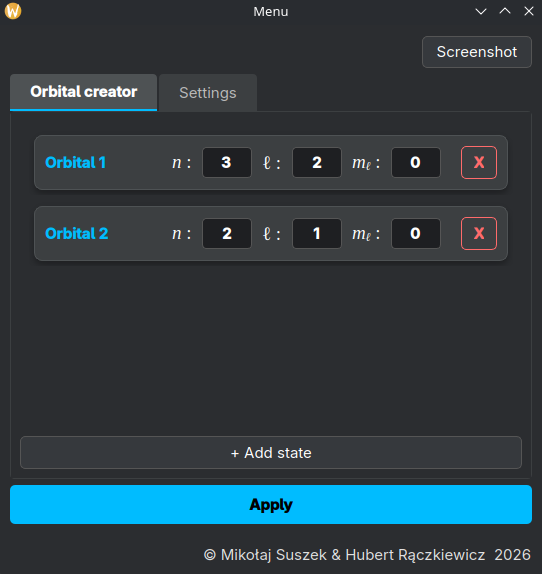
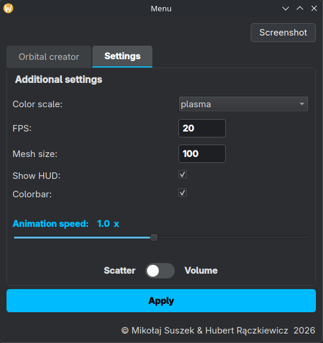

# Overview

Python based plotter for electron orbitals in hydrogen atom. 

The plotter has built in interactive GUI in which user can change the look or type of plot. There are two types of plots - scatter and volume plots. Volume Plot may be a little heavy and user can experience lower FPS compared to the scatter one. 

Multiple states are supported in one plot which has to be interpreted as a superposition between those. 

# Usage

## Setup

Clone the repository

```bash
git clone https://github.com/Serious-Physicists-Inc/ProjektWDMZF-A.T.O.M..git
```

Make sure you have installed all dependencies

```
pip install PyQt6 pyqtgraph numpy scipy PyOpenGL PyOpenGL_accelerate
```

Open folder 

```bash
cd ProjektWDMZF-A.T.O.M.
```

## Running 

To run the plotter type:

```bash
python3 -m src.main
```

## GUI

The GUI looks as shown below:

<p align="center">
  
</p>

There are two tabs: Orbital creator and Settings. Orbital creator lets you choose the 3 quantum numbers (n, l and m) which you can type. Code has some basic error handling so it should not let you add a non physical state.

You can add state by pressing button below and delete with the red 'x' beside the state you want to delete. 

By clicking apply the plot window should open. You can screenshot the current view of the plot with the button in top right.

The settings tab looks like this:

<p align="center">
  
</p>

In this tab you can manipulate color map, max fps (suggested 20 for smoother volume plot generation) and mesh size (the bigger the more detail but gets heavy quickly).

You can also choose if you want to have HUD that shows fps and current state and color bar that shows probability density distribution.

If you feel like the plot isn't moving even though you chose more than one state you can speed up the animation with slider in this tab. 

To change the plot type you have to select settings tab first.
